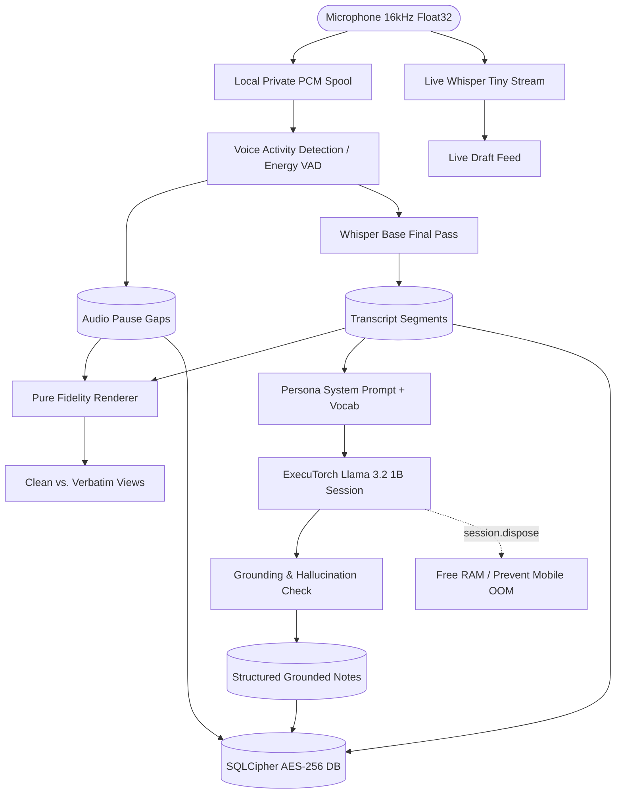

# AudioInk 🎙️∿

> **Airgapped, On-Device AI Voice Notepad & Structured Note Synthesizer**  
> Private, hardware-encrypted speech-to-text and grounded LLM note extraction running 100% locally on your phone.

---

## 🌟 Key Features

- **🛡️ 100% Airgapped & Offline by Default**  
  No audio recordings, transcripts, or notes ever leave the device. Telemetry is permanently disabled on boot (`setTelemetryEnabled(false)`). Zero cloud APIs.
- **💾 Preserves Raw Ground Truth**  
  Raw 16 kHz Float32 PCM audio and speech segments are retained permanently. Clean and Verbatim views are non-destructive mathematical projections over raw timestamps.
- **⚡ Two-Stage Speech-to-Text Pipeline**  
  - **Live Draft**: Real-time streaming transcription via **Whisper Tiny** directly as you speak.
  - **Final Pass**: Post-recording voice activity detection (VAD) and pause-calibrated segment transcription via **Whisper Base**.
- **🧠 Grounded On-Device LLM Note Synthesis**  
  Generates persona-specific structured notes using quantized **Meta Llama 3.2 1B Instruct** via PyTorch **ExecuTorch**. Every generated point strictly cites source segments (`[s1]`, `[s2]`) with automated hallucination verification.
- **🔒 Hardware-Backed SQLCipher AES-256 Storage**  
  All SQLite tables, transcripts, and notes are encrypted at rest with hardware keystore keys (`expo-secure-store` + `expo-crypto`) and optional biometric Face ID / Fingerprint lock.
- **🎨 Pure Fidelity Engine & Vocabulary Auto-Fix**  
  Collapses adjacent word repetitions, inserts exact pause duration indicators (`[pause 2.5s]`), and uses 1-edit distance Levenshtein matching to correct domain-specific jargon against persona vocabularies.
- **📱 Google Stitch Prototype UI**  
  Full 5-screen interface matching modern design standards: Library with search & category filtering, Live Capture with waveform, Dual-View Transcript Viewer, Grounded Notes with interactive citation drawer, Settings Vault, and Persona Fidelity Modal.

---

## 🏗️ Architecture



---

## 🎭 Personas & Recording Profiles

| Persona | Recording Type | Default Fidelity | Specialized Sections |
| :--- | :--- | :--- | :--- |
| **🎓 Professor** | Lecture / Seminar / Office Hours | Clean (Collapsed repeats, paragraph timestamps) | Key Concepts, Arguments, Questions Raised, Follow-ups |
| **🎵 Musician** | Idea Capture / Rehearsal | Verbatim (Exact repetitions, pause tags `[pause Xs]`) | Lyrical Themes, Melodic Motifs, Structural Notes, Next Session |
| **⚖️ Lawyer** | Client Interview / Dictation | Verbatim or Clean (Per-recording choice) | Executive Summary, Factual Record, Legal Issues, Action Items |
| **🔬 Researcher** | Lab Dictation / Literature Review | Clean (Strict vocabulary auto-correction) | Hypotheses, Observations, Data Points, Potential Biases |

---

## 📋 System Requirements & Native Constraints

- **React Native 0.86.3** with **New Architecture enabled** (`newArchEnabled: true`).
- **Expo SDK 57** (Development Builds; **Expo Go is not supported** due to custom C++ native PyTorch libraries).
- **Target OS Minimums**:
  - **Android 13+** (`minSdkVersion >= 26`)
  - **iOS 17.0+** (`deploymentTarget: 17.0`)
- **Native CPU ABIs**: `arm64-v8a`, `x86_64` (32-bit ABIs excluded to prevent runtime crashes).
- **Worklets**: `react-native-worklets` 0.10.x.

---

## 🚀 Quick Start & Development

### 1. Prerequisites
- **Node.js** (v20+ or v24 LTS recommended)
- **Android SDK** (for local Android development on Linux/macOS/Windows)
- **EAS CLI** (for cloud iOS builds)

### 2. Install Dependencies
```bash
git clone https://github.com/fayajhossain/audioink.git
cd audioink
npm install
```

### 3. Verify Codebase Health
AudioInk enforces strict TypeScript typing and clean lint checks:
```bash
# Typecheck
npx tsc --noEmit

# Static Analysis
npx expo lint
```

### 4. Build & Run

#### Android (Local Device via USB)
Connect an Android 13+ phone with USB debugging enabled:
```bash
npx expo run:android
```

#### iOS (EAS Cloud Build)
Since iOS requires Apple development certificates and macOS toolchains:
```bash
# 1. Configure EAS
npx eas-cli login

# 2. Trigger Cloud Development Build
npx eas-cli build --profile development --platform ios
```

#### Daily Development
Once the development build is installed on your physical device:
```bash
npx expo start --dev-client
```

---

## 📂 Project Structure

```
audioink/
├── app.json                       # Native config (minSdkVersion 26, iOS 17.0, SQLCipher, permissions)
├── babel.config.js                # Babel plugin setup (react-native-worklets/plugin last)
├── metro.config.js                # Metro asset extensions (.pte, .bin model bundles)
├── eas.json                       # EAS build profiles (developmentClient: true)
├── design/                        # Google Stitch UI prototype specifications & assets
└── src/
    ├── app/                       # Expo Router Screens & Navigation
    │   ├── _layout.tsx            # Root layout, telemetry opt-out & crash recovery
    │   ├── index.tsx              # Notes Library with search & category filter pills
    │   ├── record.tsx             # Live voice capture, waveform visualizer & draft feed
    │   ├── transcript/[id].tsx    # Dual-view transcript viewer (Clean vs. Verbatim)
    │   ├── notes/[id].tsx         # Structured note viewer with clickable citation bottom sheet
    │   ├── settings.tsx           # Privacy vault, storage meter & AI model registry
    │   └── persona-modal.tsx      # Persona & fidelity configuration modal
    ├── core/
    │   ├── renderer/              # Pure fidelity transcript renderer
    │   │   ├── index.ts           # Repetition collapsing, pause markers, vocabulary correction
    │   │   └── __tests__/         # Unit test suite
    ├── services/
    │   ├── audio/                 # 16 kHz Float32 PCM recording & interruption handling
    │   ├── transcription/         # Whisper streaming & FSMN / energy VAD final pass
    │   ├── llm/                   # ExecuTorch session runner, prompt builder & citation verifier
    │   ├── storage/               # Encrypted SQLite database & app-private audio spooler
    │   ├── persona-state.ts       # Active persona observable state
    │   └── telemetry.ts           # Telemetry opt-out enforcer
    ├── types/                     # Fidelity and recording domain models
    └── constants/                 # Theme tokens and persona definitions
```

---

## 🔒 Security & Privacy Guarantees

1. **Zero External Requests**: AudioInk makes no network calls during audio recording, transcription, or note synthesis.
2. **Crash Recovery**: If the device runs out of battery or the OS kills the process during recording, [`recoverInterruptedRecordings()`](file:///home/shaman/code/audioink/src/services/storage/database.ts) reconciles unfinished sessions on the next boot without data loss.
3. **Cascade Purge**: Deleting a recording safely removes the audio file from disk (`.pcm`) and automatically cascades deletion across all child segments, pauses, and structured notes via foreign key constraints.

---

## 📄 License

MIT © [Md Fayaj Hossain](https://github.com/fayajhossain)
